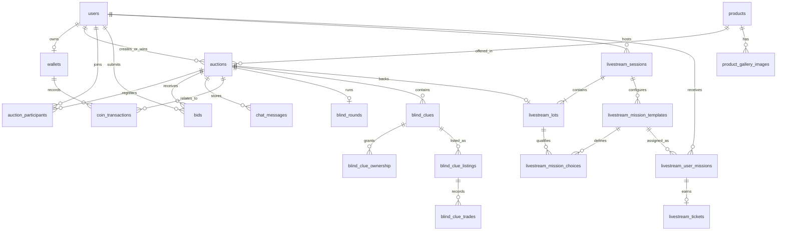

# Mô tả cơ sở dữ liệu — phiên bản cuối theo code hiện tại

Đối chiếu ngày **23/11/2026** với SQL khởi tạo, migration và các service trong repository. Tài liệu mô tả schema mà các chức năng hiện tại sử dụng; không khẳng định một database đang triển khai đã được nâng cấp đầy đủ.

## 1. Tổng quan và quy ước

Hệ thống sử dụng **MySQL, InnoDB**, hỗ trợ NORMAL, BLIND và LIVESTREAM. Từ 8 bảng ban đầu, schema hiện có **28 bảng nghiệp vụ**; bảng kỹ thuật `flyway_schema_history` không tính vào số này.

| Nhóm                         | Số bảng | Các bảng                                                                                                                                                              |
| ---------------------------- | ------: | --------------------------------------------------------------------------------------------------------------------------------------------------------------------- |
| Tài khoản và Coin            |       3 | `users`, `wallets`, `coin_transactions`                                                                                                                               |
| Sản phẩm                     |       2 | `products`, `product_gallery_images`                                                                                                                                  |
| Đấu giá dùng chung và NORMAL |       5 | `auctions`, `auction_participants`, `bids`, `chat_messages`, `auction_normal_timing`                                                                                  |
| BLIND                        |       7 | `blind_settings`, `blind_clues`, `blind_system_clues`, `blind_rounds`, `blind_clue_ownership`, `blind_clue_listings`, `blind_clue_trades`                             |
| Livestream cơ bản            |       7 | `livestream_sessions`, `livestream_lots`, `livestream_participants`, `livestream_registrations`, `livestream_chat`, `livestream_notifications`, `livestream_commands` |
| Săn vé bí ẩn                 |       4 | `livestream_mission_templates`, `livestream_mission_choices`, `livestream_user_missions`, `livestream_tickets`                                                        |
| **Tổng**                     |  **28** |                                                                                                                                                                       |

Quy ước đọc từ điển dữ liệu:

- **PK**: khóa chính; **FK**: khóa ngoại đã khai báo trong DDL; **UQ**: ràng buộc duy nhất; **AI**: tự tăng.
- Cột mặc định là `NOT NULL`; cột cho phép rỗng được ghi rõ **NULL**. Khóa ghép và UQ ghép được ghi sau từng bảng.
- `U64` là `BIGINT UNSIGNED`; `U32` là `INT UNSIGNED`; `DT` là `DATETIME(6)`. `BIGINT` không có UNSIGNED là số nguyên có dấu.
- Thời gian được lưu và xử lý theo UTC; `DATETIME(6)` không tự mang thông tin múi giờ. `BOOLEAN` là kiểu boolean của MySQL, tương đương `TINYINT(1)`.
- ID và Coin dùng số nguyên; dù DB có cột UNSIGNED, code Java dùng `long` và kiểm tra trong giới hạn signed BIGINT. Các bảng nền tảng khai báo `utf8mb4_unicode_ci`; bảng livestream trong migration chỉ khai báo InnoDB và kế thừa charset/collation của database.

## 2. Tài khoản và ví Coin

### 2.1. `users` — tài khoản

| Cột             | Kiểu / ràng buộc     | Ý nghĩa              |
| --------------- | -------------------- | -------------------- |
| `id`            | U64, PK, AI          | Định danh tài khoản. |
| `username`      | VARCHAR(50), UQ      | Tên đăng nhập.       |
| `password_hash` | VARCHAR(255)         | Mật khẩu đã băm.     |
| `role`          | ENUM('USER','ADMIN') | Vai trò tài khoản.   |

Không có bảng Admin riêng; phân biệt bằng `role`. Bảng hiện không có cột `status`, email hoặc ảnh đại diện.

### 2.2. `wallets` — ví người dùng và ví hệ thống

| Cột                 | Kiểu / ràng buộc               | Ý nghĩa                              |
| ------------------- | ------------------------------ | ------------------------------------ |
| `id`                | U64, PK, AI                    | Định danh ví.                        |
| `user_id`           | U64, NULL, UQ, FK → `users.id` | Chủ ví USER; NULL với ví SYSTEM.     |
| `wallet_type`       | ENUM('USER','SYSTEM')          | Loại ví.                             |
| `available_balance` | U64                            | Coin khả dụng.                       |
| `locked_balance`    | U64                            | Tổng Coin đang giữ cho các lượt đấu. |
| `updated_at`        | DT                             | Lần cập nhật số dư gần nhất.         |

DB có CHECK bảo đảm USER có `user_id`, SYSTEM không có `user_id`. UQ trên `user_id` giới hạn một ví cho mỗi tài khoản, nhưng **không giới hạn số ví SYSTEM** vì MySQL cho phép nhiều giá trị NULL. Code `WalletLedger.systemId()` yêu cầu đúng một ví SYSTEM. Không lưu `total_balance`; tổng số dư bằng khả dụng cộng đang khóa.

### 2.3. `coin_transactions` — sổ giao dịch Coin

| Cột                | Kiểu / ràng buộc                                       | Ý nghĩa                                |
| ------------------ | ------------------------------------------------------ | -------------------------------------- |
| `id`               | U64, PK, AI                                            | Định danh bút toán.                    |
| `wallet_id`        | U64, FK → `wallets.id`                                 | Ví phát sinh biến động.                |
| `auction_id`       | U64, NULL, FK → `auctions.id`                          | Lượt đấu liên quan; NULL khi nạp Coin. |
| `transaction_type` | ENUM('DEPOSIT','LOCK','UNLOCK','PAYMENT','CLUE_TRADE') | Loại biến động.                        |
| `available_delta`  | BIGINT                                                 | Chênh lệch Coin khả dụng, có thể âm.   |
| `locked_delta`     | BIGINT                                                 | Chênh lệch Coin đang khóa, có thể âm.  |
| `created_at`       | DT                                                     | Thời điểm ghi bút toán.                |

Bảng hiện **không có cột `description`** như bản đề xuất cũ. Coin giữ cho từng ví/từng lượt được dựng lại bằng tổng `locked_delta` theo `wallet_id`, `auction_id`; không có bảng hold riêng.

| Nghiệp vụ với số Coin `x` | Ví          | `available_delta` | `locked_delta` |
| ------------------------- | ----------- | ----------------: | -------------: |
| DEPOSIT                   | USER        |                +x |              0 |
| LOCK                      | USER        |                −x |             +x |
| UNLOCK                    | USER        |                +x |             −x |
| PAYMENT                   | Người thắng |                 0 |             −x |
| PAYMENT                   | SYSTEM      |                +x |              0 |
| CLUE_TRADE                | Người mua   |                −x |              0 |
| CLUE_TRADE                | Người bán   |                +x |              0 |

PAYMENT và CLUE_TRADE tạo hai bút toán trên hai ví trong cùng transaction. Mua Clue không chuyển Coin qua ví SYSTEM.

## 3. Sản phẩm

### 3.1. `products` — thông tin sản phẩm

| Cột               | Kiểu / ràng buộc   | Ý nghĩa                             |
| ----------------- | ------------------ | ----------------------------------- |
| `id`              | U64, PK, AI        | Định danh sản phẩm.                 |
| `name`            | VARCHAR(255)       | Tên sản phẩm.                       |
| `description`     | TEXT, NULL         | Mô tả sản phẩm.                     |
| `estimated_price` | U64, NULL          | Giá ước tính nội bộ, phục vụ Admin. |
| `quantity`        | U32                | Tổng số đơn vị hàng.                |
| `image_url`       | VARCHAR(500), NULL | Đường dẫn ảnh chính.                |

Một sản phẩm có nhiều lượt đấu. `estimated_price` khác `auctions.starting_price` và giá bán thống kê. Ảnh được lưu thành file; DB lưu đường dẫn, không lưu BLOB ảnh.

Số hàng khả dụng được tính từ `quantity` trừ số lượt đang giữ/bán hàng theo `ProductStockSql`: UPCOMING, RUNNING, SOLD hoặc thuộc livestream chưa ENDED. Không có cột `available_quantity` hay bảng tồn kho riêng; kết quả UNSOLD trong livestream chưa kết thúc vẫn có thể giữ hàng để đấu lại.

### 3.2. `product_gallery_images` — ảnh bổ sung

| Cột          | Kiểu / ràng buộc                           | Ý nghĩa                                   |
| ------------ | ------------------------------------------ | ----------------------------------------- |
| `id`         | U64, PK, AI                                | Định danh ảnh, đồng thời dùng sắp thứ tự. |
| `product_id` | U64, FK → `products.id`, ON DELETE CASCADE | Sản phẩm sở hữu ảnh.                      |
| `image_url`  | VARCHAR(500)                               | Đường dẫn ảnh bổ sung.                    |

Ảnh được lấy theo `id` tăng dần; không có cột `position`. Giới hạn số ảnh được kiểm tra trong service.

## 4. Đấu giá dùng chung và NORMAL

### 4.1. `auctions` — một lượt đấu cho một sản phẩm

| Cột                 | Kiểu / ràng buộc                                       | Ý nghĩa                                                |
| ------------------- | ------------------------------------------------------ | ------------------------------------------------------ |
| `id`                | U64, PK, AI                                            | Định danh lượt đấu.                                    |
| `product_id`        | U64, FK → `products.id`                                | Sản phẩm được đấu.                                     |
| `created_by`        | U64, FK → `users.id`                                   | Admin tạo lượt.                                        |
| `auction_type`      | ENUM('NORMAL','BLIND','LIVESTREAM')                    | Chế độ đấu giá.                                        |
| `access_type`       | ENUM('PUBLIC','PRIVATE')                               | Quyền truy cập.                                        |
| `room_code`         | VARCHAR(50), NULL                                      | Mã phòng PRIVATE.                                      |
| `max_participants`  | U32, NULL                                              | Sức chứa theo cấu hình.                                |
| `starting_price`    | U64                                                    | Giá khởi điểm; là giá sàn bí mật với BLIND.            |
| `min_bid_increment` | U64, NULL                                              | Bước giá NORMAL.                                       |
| `start_time`        | DT                                                     | Lịch bắt đầu hoặc thời điểm mở đấu thực tế tùy chế độ. |
| `end_time`          | DT, NULL                                               | Hạn hiện tại, có thể thay đổi khi gia hạn.             |
| `finished_at`       | DT, NULL                                               | Thời điểm hoàn tất xử lý kết quả.                      |
| `status`            | ENUM('UPCOMING','RUNNING','SOLD','UNSOLD','CANCELLED') | Trạng thái lượt đấu trên schema đã nâng cấp BLIND.     |
| `winner_user_id`    | U64, NULL, FK → `users.id`                             | Người thắng.                                           |
| `winning_price`     | U64, NULL                                              | Giá đã chốt bán.                                       |

Các CHECK chính trong schema sau nâng cấp:

- `starting_price > 0`; NORMAL có bước giá dương; BLIND/LIVESTREAM có `min_bid_increment = NULL`.
- NORMAL/BLIND phải có `end_time > start_time`. LIVESTREAM được để `end_time = NULL`; nếu có thì phải sau `start_time`.
- PUBLIC có `room_code = NULL`; PRIVATE có mã phòng.
- SOLD phải có người thắng, giá thắng và `finished_at`; UNSOLD/CANCELLED có `finished_at` nhưng không có người thắng/giá thắng. Các chi tiết CHECK của database cũ phụ thuộc migration đã áp dụng, xem mục 11.

`current_price` và `leader` được truy vấn từ `bids`, không lưu thành cột. Một phiên livestream nhiều món được biểu diễn bằng một `livestream_sessions` và nhiều `auctions`, mỗi món tương ứng một `livestream_lots`.

### 4.2. `auction_participants` — lịch sử tham gia lượt đấu

| Cột          | Kiểu / ràng buộc        | Ý nghĩa                      |
| ------------ | ----------------------- | ---------------------------- |
| `auction_id` | U64, FK → `auctions.id` | Lượt đấu.                    |
| `user_id`    | U64, FK → `users.id`    | Người tham gia.              |
| `joined_at`  | DT                      | Thời điểm ghi nhận tham gia. |

**PK (`auction_id`, `user_id`)**. Phục vụ quyền phòng, lịch sử và bảng xếp hạng; không biểu diễn trạng thái online. Với livestream, vào phòng được lưu tại `livestream_participants`; `auction_participants` của món được thêm khi người dùng bid.

### 4.3. `bids` — các lần đặt giá được chấp nhận

| Cột          | Kiểu / ràng buộc        | Ý nghĩa                                 |
| ------------ | ----------------------- | --------------------------------------- |
| `id`         | U64, PK, AI             | Định danh bid.                          |
| `auction_id` | U64, FK → `auctions.id` | Lượt đấu nhận bid.                      |
| `user_id`    | U64, FK → `users.id`    | Người đặt giá.                          |
| `amount`     | U64                     | Số Coin đặt.                            |
| `created_at` | DT                      | Thời điểm server ghi nhận.              |
| `request_id` | VARCHAR(36), NULL       | Chống xử lý lại yêu cầu bid livestream. |

**UQ (`auction_id`, `user_id`, `request_id`)**. NORMAL/BLIND hiện ghi NULL cho `request_id`; UQ này vẫn cho phép nhiều bid của một người.

- NORMAL nhận nhiều bid tăng dần theo bước giá. LIVESTREAM nhận bid đầu đạt giá khởi điểm, các bid sau cao hơn giá trước.
- BLIND lưu mỗi lần xác nhận/sửa thành một dòng mới. Chỉ dòng cuối theo `created_at DESC, id DESC` của mỗi người được xét; sau đó xếp `amount DESC, created_at ASC, id ASC` để chọn người thắng đạt giá sàn.
- Không có UQ (`auction_id`, `user_id`) và không có cột `is_latest`.

### 4.4. `chat_messages` — chat NORMAL/BLIND

| Cột          | Kiểu / ràng buộc        | Ý nghĩa             |
| ------------ | ----------------------- | ------------------- |
| `id`         | U64, PK, AI             | Định danh tin nhắn. |
| `auction_id` | U64, FK → `auctions.id` | Phòng đấu giá.      |
| `user_id`    | U64, FK → `users.id`    | Người gửi.          |
| `content`    | TEXT                    | Nội dung chat.      |
| `sent_at`    | DT                      | Thời điểm gửi.      |

Giới hạn độ dài, tần suất và quyền gửi do server kiểm tra. Chat livestream dùng bảng riêng ở mục 6.5.

### 4.5. `auction_normal_timing` — nhịp và gia hạn NORMAL

| Cột                      | Kiểu / ràng buộc | Ý nghĩa                                                                  |
| ------------------------ | ---------------- | ------------------------------------------------------------------------ |
| `auction_id`             | BIGINT, PK       | Liên kết logic tới `auctions.id`; **không khai báo FK**, kiểu có dấu.    |
| `closing_window_seconds` | INT              | Ngưỡng cuối phiên dùng cho nhịp cuối và kiểm tra gia hạn.                |
| `extension_seconds`      | INT              | Thời gian phản hồi được bảo đảm từ bid sát giờ.                          |
| `leaderboard_seconds`    | INT              | Ngưỡng hiển thị trạng thái chốt giá/BXH cuối phiên.                      |
| `scheduled_end_time`     | DT, NULL         | Hạn theo lịch ban đầu, giữ ổn định khi `auctions.end_time` được gia hạn. |

Code hiện mặc định **10/10/60 giây** khi không có cấu hình; kiểm tra mỗi giá trị 1–3600 và `extension_seconds >= closing_window_seconds`. Các nhịp được tính từ thời gian, không có bảng phase riêng. Bảng/cột này được `NormalTimingRepository` tạo bổ sung khi khởi động.

## 5. Đấu giá mù: cấu hình, Clue và giao dịch

### 5.1. `blind_settings` — cấu hình BLIND

| Cột             | Kiểu / ràng buộc            | Ý nghĩa                         |
| --------------- | --------------------------- | ------------------------------- |
| `auction_id`    | U64, PK, FK → `auctions.id` | Phiên BLIND.                    |
| `opened_at`     | DT, NULL                    | Thời điểm mở phòng chờ thực tế. |
| `trade_seconds` | U32, DEFAULT 300            | Thời lượng TRADE; CHECK 1–3600. |
| `bid_seconds`   | U32, DEFAULT 100            | Thời lượng BID; CHECK 1–3600.   |

Sức chứa nằm ở `auctions.max_participants` và được code giới hạn 3–30. Hạn chờ 5 phút, REVEAL 20 giây và DISCUSS 60 giây là quy tắc trong code, không phải cột riêng.

### 5.2. `blind_clues` — Clue pool riêng của phiên

| Cột          | Kiểu / ràng buộc        | Ý nghĩa                                |
| ------------ | ----------------------- | -------------------------------------- |
| `id`         | U64, PK, AI             | Định danh Clue.                        |
| `auction_id` | U64, FK → `auctions.id` | Phiên sở hữu pool.                     |
| `slot`       | TINYINT UNSIGNED        | Vị trí trong pool; CHECK 1–100 sau V3. |
| `content`    | VARCHAR(500)            | Nội dung manh mối.                     |

**UQ (`auction_id`, `slot`)**, **UQ (`auction_id`, `id`)**. Code yêu cầu số Clue ít nhất bằng sức chứa, tối đa 100 và nội dung khác nhau. Khi bắt đầu, server chọn ngẫu nhiên mỗi người một Clue; không phát toàn bộ pool cho người chơi.

### 5.3. `blind_system_clues` — Clue công bố chung theo lịch

| Cột          | Kiểu / ràng buộc        | Ý nghĩa                     |
| ------------ | ----------------------- | --------------------------- |
| `auction_id` | U64, FK → `auctions.id` | Phiên BLIND.                |
| `slot`       | INT                     | Thứ tự công bố; CHECK 1–10. |
| `content`    | VARCHAR(500)            | Nội dung manh mối hệ thống. |

**PK (`auction_id`, `slot`)**. Cho phép không có Clue hệ thống. Thời điểm công bố được tính đều trong giai đoạn BID từ thứ tự và số Clue; không lưu cột `revealed_at`.

### 5.4. `blind_rounds` — các mốc thời gian lượt chơi

| Cột             | Kiểu / ràng buộc            | Ý nghĩa                                                  |
| --------------- | --------------------------- | -------------------------------------------------------- |
| `auction_id`    | U64, PK, FK → `auctions.id` | Phiên đã thực sự bắt đầu chơi.                           |
| `started_at`    | DT                          | Bắt đầu REVEAL.                                          |
| `trade_ends_at` | DT                          | Kết thúc TRADE.                                          |
| `bid_locks_at`  | DT                          | Cột tương thích dữ liệu cũ; lượt mới ghi bằng `ends_at`. |
| `ends_at`       | DT                          | Kết thúc BID và đến hạn quyết toán.                      |

Giai đoạn hiện tại được tính theo các mốc: REVEAL → TRADE → DISCUSS → BID → kết thúc. Không còn giai đoạn khóa bid sớm 20 giây; người chơi được sửa đến hết BID.

### 5.5. `blind_clue_ownership` — quyền biết Clue

| Cột           | Kiểu / ràng buộc     | Ý nghĩa                     |
| ------------- | -------------------- | --------------------------- |
| `auction_id`  | U64                  | Phiên chứa Clue.            |
| `clue_id`     | U64                  | Clue đã được nhận hoặc mua. |
| `user_id`     | U64, FK → `users.id` | Người được biết nội dung.   |
| `acquired_at` | DT                   | Thời điểm nhận quyền.       |

**PK (`clue_id`, `user_id`)**; **FK (`auction_id`, `clue_id`) → `blind_clues(auction_id, id)`**. Một Clue có thể được nhiều người biết: giao dịch thêm quyền cho người mua, không xóa quyền của người bán.

### 5.6. `blind_clue_listings` — tin bán Clue

| Cột          | Kiểu / ràng buộc     | Ý nghĩa                              |
| ------------ | -------------------- | ------------------------------------ |
| `id`         | U64, PK, AI          | Định danh tin bán.                   |
| `auction_id` | U64                  | Phiên giao dịch.                     |
| `clue_id`    | U64                  | Clue được chào bán.                  |
| `seller_id`  | U64, FK → `users.id` | Người bán.                           |
| `price`      | U64                  | Giá bán; CHECK > 0.                  |
| `version`    | U64                  | Phiên bản tin, tăng khi sửa giá/hủy. |
| `active`     | BOOLEAN              | Tin còn mở hay đã đóng.              |

**UQ (`clue_id`, `seller_id`)**; **FK (`auction_id`, `clue_id`) → `blind_clues(auction_id, id)`**. Người mua gửi version để tránh mua theo giá cũ. Giới hạn mỗi người một lượt đăng bán và không bán lại Clue đã giao dịch được kiểm tra trong service.

### 5.7. `blind_clue_trades` — giao dịch Clue thành công

| Cột          | Kiểu / ràng buộc                   | Ý nghĩa                         |
| ------------ | ---------------------------------- | ------------------------------- |
| `id`         | U64, PK, AI                        | Định danh giao dịch.            |
| `auction_id` | U64                                | Phiên phát sinh.                |
| `clue_id`    | U64                                | Clue được mua.                  |
| `listing_id` | U64, FK → `blind_clue_listings.id` | Tin bán nguồn.                  |
| `buyer_id`   | U64, FK → `users.id`               | Người mua.                      |
| `seller_id`  | U64, FK → `users.id`               | Người bán.                      |
| `price`      | U64                                | Giá thực trả tại thời điểm mua. |
| `created_at` | DT                                 | Thời điểm giao dịch.            |

**FK (`auction_id`, `clue_id`) → `blind_clues(auction_id, id)`**. DDL chưa có UQ trên `clue_id`; quy tắc chỉ bán thành công một lần do service kiểm tra khi đang khóa hàng auction. Bản ghi giao dịch, quyền biết Clue và hai bút toán Coin được cập nhật cùng transaction.

## 6. Livestream cơ bản

### 6.1. `livestream_sessions` — một chương trình phát trực tiếp

| Cột                 | Kiểu / ràng buộc                                                                 | Ý nghĩa                                                                              |
| ------------------- | -------------------------------------------------------------------------------- | ------------------------------------------------------------------------------------ |
| `id`                | U64, PK, AI                                                                      | Định danh chương trình.                                                              |
| `host_id`           | U64, FK → `users.id`                                                             | Admin tạo và điều khiển phiên.                                                       |
| `create_request_id` | VARCHAR(36)                                                                      | Mã chống tạo lặp.                                                                    |
| `title`             | VARCHAR(120)                                                                     | Tiêu đề.                                                                             |
| `description`       | VARCHAR(1000)                                                                    | Mô tả.                                                                               |
| `starts_at`         | DT                                                                               | Lịch phát.                                                                           |
| `status`            | ENUM('SCHEDULED','LIVE','PAUSED','ENDED'), DEFAULT 'SCHEDULED'                   | Trạng thái toàn chương trình.                                                        |
| `current_lot_index` | U32, DEFAULT 0                                                                   | Position của món đang được chọn.                                                     |
| `revision`          | U64, DEFAULT 0                                                                   | Phiên bản trạng thái để đồng bộ client.                                              |
| `host_socket_id`    | VARCHAR(100), NULL                                                               | Socket host hiện tại phục vụ nhận diện/khôi phục.                                    |
| `host_last_seen`    | DT, NULL                                                                         | Heartbeat gần nhất.                                                                  |
| `publisher_ready`   | BOOLEAN, DEFAULT FALSE                                                           | Host đã sẵn sàng phát media.                                                         |
| `media_generation`  | U64, DEFAULT 0                                                                   | Thế hệ kết nối media, loại signaling cũ.                                             |
| `remaining_ms`      | BIGINT, NULL                                                                     | Thời gian bid còn lại khi tạm dừng.                                                  |
| `pause_until`       | DT, NULL                                                                         | Hạn chờ tiếp tục phiên.                                                              |
| `mystery_enabled`   | BOOLEAN, DEFAULT FALSE                                                           | Có bật Săn vé bí ẩn.                                                                 |
| `final_state`       | ENUM('DISABLED','LOCKED','REVEALED','OPEN','SOLD','SKIPPED'), DEFAULT 'DISABLED' | Trạng thái vòng bí mật.                                                              |
| `mystery_config`    | TEXT, NULL                                                                       | Chuỗi JSON chuẩn hóa dùng đối chiếu cấu hình khi retry tạo phiên; có dữ liệu bí mật. |

**UQ (`host_id`, `create_request_id`)**. DB lưu một phần trạng thái phục hồi host; kết nối thật và presence vẫn do runtime quản lý. Không lưu video, âm thanh hoặc toàn bộ SDP/ICE vào bảng.

### 6.2. `livestream_lots` — các món trong chương trình

| Cột          | Kiểu / ràng buộc                                                     | Ý nghĩa                                      |
| ------------ | -------------------------------------------------------------------- | -------------------------------------------- |
| `id`         | U64, PK, AI                                                          | Định danh món/lượt trong live.               |
| `session_id` | U64, FK → `livestream_sessions.id`                                   | Chương trình chứa món.                       |
| `auction_id` | U64, FK → `auctions.id`                                              | Lượt đấu chứa sản phẩm, giá, bid và kết quả. |
| `position`   | U32                                                                  | Vị trí, bắt đầu từ 0.                        |
| `phase`      | ENUM('QUEUED','PRESENTING','OPEN','SOLD','UNSOLD'), DEFAULT 'QUEUED' | Trạng thái điều hành món.                    |
| `lot_kind`   | ENUM('REGULAR','SECRET'), DEFAULT 'REGULAR'                          | Món thường hoặc món bí mật.                  |

**UQ (`auction_id`)**, **UQ (`session_id`, `position`)**. Mỗi lot dùng một auction riêng; không sao chép `product_id`, giá hoặc winner vào bảng lot. Deadline nằm ở `auctions.end_time`, được đặt lại 5 giây sau mỗi bid hợp lệ.

### 6.3. `livestream_participants` — người từng vào phòng

| Cột           | Kiểu / ràng buộc                   | Ý nghĩa                               |
| ------------- | ---------------------------------- | ------------------------------------- |
| `session_id`  | U64, FK → `livestream_sessions.id` | Phòng live.                           |
| `user_id`     | U64, FK → `users.id`               | Người vào phòng.                      |
| `seat_number` | U32                                | Số ghế được cấp và giữ khi reconnect. |

**PK (`session_id`, `user_id`)**; **UQ (`session_id`, `seat_number`)**. Đây là lịch sử ghế, không phải danh sách kết nối online. Giới hạn 10 kết nối người xem do `LivePresence` kiểm soát, không phải CHECK trên số ghế.

### 6.4. `livestream_registrations` — đăng ký theo dõi lịch phát

| Cột          | Kiểu / ràng buộc                   | Ý nghĩa               |
| ------------ | ---------------------------------- | --------------------- |
| `session_id` | U64, FK → `livestream_sessions.id` | Chương trình đăng ký. |
| `user_id`    | U64, FK → `users.id`               | Tài khoản đăng ký.    |

**PK (`session_id`, `user_id`)**. Độc lập với việc đã vào phòng hay đã bid.

### 6.5. `livestream_chat` — chat theo chương trình

| Cột          | Kiểu / ràng buộc                   | Ý nghĩa             |
| ------------ | ---------------------------------- | ------------------- |
| `id`         | U64, PK, AI                        | Định danh tin nhắn. |
| `session_id` | U64, FK → `livestream_sessions.id` | Phòng live.         |
| `user_id`    | U64, FK → `users.id`               | Người gửi.          |
| `request_id` | VARCHAR(36)                        | Mã chống gửi trùng. |
| `content`    | VARCHAR(500)                       | Nội dung.           |
| `sent_at`    | DT                                 | Thời điểm gửi.      |

**UQ (`session_id`, `user_id`, `request_id`)**. Chat gắn toàn chương trình, không tách thành một phòng cho từng món.

### 6.6. `livestream_notifications` — thông báo bắt đầu live

| Cột          | Kiểu / ràng buộc                   | Ý nghĩa                          |
| ------------ | ---------------------------------- | -------------------------------- |
| `session_id` | U64, FK → `livestream_sessions.id` | Chương trình đã bắt đầu.         |
| `user_id`    | U64, FK → `users.id`               | Người đã đăng ký nhận thông báo. |
| `created_at` | DT                                 | Thời điểm tạo thông báo.         |

**PK (`session_id`, `user_id`)**. Được tạo từ danh sách đăng ký khi host START; không có cột đã đọc/chưa đọc.

### 6.7. `livestream_commands` — chống thực hiện lặp lệnh host

| Cột          | Kiểu / ràng buộc                   | Ý nghĩa                                                  |
| ------------ | ---------------------------------- | -------------------------------------------------------- |
| `session_id` | U64, FK → `livestream_sessions.id` | Chương trình nhận lệnh.                                  |
| `user_id`    | U64, FK → `users.id`               | Host gửi lệnh.                                           |
| `request_id` | VARCHAR(36)                        | Định danh yêu cầu.                                       |
| `command`    | VARCHAR(20)                        | Lệnh như start, select, open, next, reopen, resume, end. |
| `lot_id`     | U64, NULL                          | Lot mục tiêu; **không khai báo FK** trong DDL.           |

**PK (`session_id`, `user_id`, `request_id`)**. Service kiểm tra lot thuộc đúng phiên và từ chối tái sử dụng request ID cho lệnh/nội dung khác. Đây không phải bảng nhật ký sự kiện đầy đủ: không có timestamp hay kết quả lệnh riêng.

## 7. Săn vé bí ẩn

### 7.1. `livestream_mission_templates` — mẫu nhiệm vụ

| Cột          | Kiểu / ràng buộc                   | Ý nghĩa                         |
| ------------ | ---------------------------------- | ------------------------------- |
| `id`         | U64, PK, AI                        | Định danh mẫu.                  |
| `session_id` | U64, FK → `livestream_sessions.id` | Phiên sở hữu mẫu.               |
| `position`   | U32                                | Thứ tự cấu hình.                |
| `title`      | VARCHAR(200)                       | Tên/nội dung ngắn của nhiệm vụ. |

**UQ (`session_id`, `position`)**. Một phiên có thể có nhiều mẫu; mỗi người được gán ngẫu nhiên một mẫu còn khả thi khi tham gia.

### 7.2. `livestream_mission_choices` — các lựa chọn của hai nhóm nhiệm vụ

| Cột           | Kiểu / ràng buộc                            | Ý nghĩa                         |
| ------------- | ------------------------------------------- | ------------------------------- |
| `template_id` | U64, FK → `livestream_mission_templates.id` | Mẫu nhiệm vụ.                   |
| `group_key`   | ENUM('A','B')                               | Nhóm lựa chọn.                  |
| `lot_id`      | U64, FK → `livestream_lots.id`              | Món thường thỏa nhóm tương ứng. |

**PK (`template_id`, `group_key`, `lot_id`)**. Một lot có thể xuất hiện trong cả hai nhóm, nhưng hoàn thành nhiệm vụ phải mua hai `product_id` khác nhau. Điều kiện cùng phiên, thuộc món REGULAR và có cặp hợp lệ do code kiểm tra.

### 7.3. `livestream_user_missions` — nhiệm vụ riêng đã giao

| Cột           | Kiểu / ràng buộc                            | Ý nghĩa                  |
| ------------- | ------------------------------------------- | ------------------------ |
| `session_id`  | U64, FK → `livestream_sessions.id`          | Phiên chơi.              |
| `user_id`     | U64, FK → `users.id`                        | Người nhận.              |
| `template_id` | U64, FK → `livestream_mission_templates.id` | Mẫu đã giao.             |
| `assigned_at` | DT                                          | Thời điểm giao nhiệm vụ. |

**PK (`session_id`, `user_id`)** bảo đảm một nhiệm vụ/người/phiên và giữ nguyên khi reconnect. Không có cột progress; tiến độ được tính từ sản phẩm đã thắng và bút toán PAYMENT của chính người chơi trong phiên.

### 7.4. `livestream_tickets` — vé tham gia vòng bí mật

| Cột          | Kiểu / ràng buộc | Ý nghĩa        |
| ------------ | ---------------- | -------------- |
| `session_id` | U64              | Phiên cấp vé.  |
| `user_id`    | U64              | Người có vé.   |
| `issued_at`  | DT               | Thời điểm cấp. |

**PK (`session_id`, `user_id`)**; **FK (`session_id`, `user_id`) → `livestream_user_missions(session_id, user_id)`**. Mỗi người nhận tối đa một vé trong phiên; vé không chuyển nhượng. Cấp vé cùng transaction thanh toán món hoàn thành nhiệm vụ.

Vòng bí mật được mở theo luồng `LOCKED → REVEALED → OPEN → SOLD`. Chỉ tiết lộ sau khi mọi món REGULAR đã SOLD và có vé được cấp. Kết thúc khi chưa tiết lộ chuyển thành SKIPPED; món đã tiết lộ nhưng chưa bán giữ REVEALED. Service kiểm tra vé của đúng người, đúng phiên trước khi nhận bid vòng cuối.

## 8. Quan hệ giữa các nhóm bảng

Sơ đồ rút gọn sau thể hiện các liên kết nghiệp vụ chính; từ điển từng bảng ở trên ghi đầy đủ các FK và khóa ghép.

Các quan hệ cần phân biệt:

- USER có một ví cá nhân theo luồng đăng ký; tài khoản ADMIN không bắt buộc có ví. Ví SYSTEM không gắn tài khoản.
- Quan hệ người dùng–lượt đấu là N–N qua `auction_participants`; người dùng–chương trình live là N–N qua `livestream_participants`.
- `livestream_sessions.status`, `livestream_lots.phase` và `auctions.status` mô tả ba cấp khác nhau: chương trình, điều hành món và kết quả lượt đấu.
- `auction_normal_timing.auction_id` và `livestream_commands.lot_id` là liên kết logic, không có FK trong schema hiện tại. Phần lớn FK không khai báo CASCADE; ngoại lệ ảnh gallery đã nêu ở mục 3.2.

## 9. Dữ liệu tính toán và quyền hiển thị

### 9.1. Dữ liệu không có bảng lưu riêng

| Dữ liệu                     | Nguồn và cách xác định                                                                                                                                                          |
| --------------------------- | ------------------------------------------------------------------------------------------------------------------------------------------------------------------------------- |
| Giá hiện tại, người dẫn đầu | Truy vấn `bids` theo quy tắc từng chế độ.                                                                                                                                       |
| Coin khóa theo lượt đấu     | Tổng `coin_transactions.locked_delta` theo ví và auction, đối chiếu `wallets.locked_balance`.                                                                                   |
| Thống kê giá sản phẩm       | Từ các auction SOLD có `winning_price`, `finished_at`: số bán, trung bình, min/max, giá gần nhất, trung vị khi đủ 5 mẫu. API thống kê này dành cho Admin.                       |
| Bảng xếp hạng               | Từ `users`, `auction_participants`, `auctions`, `blind_rounds`; đếm tham gia, thắng và tỷ lệ thắng. Code hiện xét NORMAL hoặc BLIND có round, chưa tính LIVESTREAM vào BXH này. |
| Replay NORMAL               | Từ auction, bid, chat và kết quả.                                                                                                                                               |
| Diễn biến BLIND             | Từ các lần đặt/sửa bid, Clue trades, nội dung Clue, lịch Clue hệ thống và kết quả; không đưa chat vào diễn biến BLIND.                                                          |
| Lịch sử mua livestream      | Từ `livestream_lots` nối auction SOLD và winner; không có bảng orders riêng.                                                                                                    |
| Tiến độ nhiệm vụ            | Đối chiếu món thường đã mua, hai nhóm lựa chọn và PAYMENT của người chơi.                                                                                                       |
| Số lượng hàng khả dụng      | Từ `products.quantity` và các auction đang giữ/bán hàng.                                                                                                                        |

Không có bảng `leaderboard`, `price_statistics`, `replays`, `socket_connections`, `orders` hoặc `chat_rooms`. Presence và kết nối socket chủ yếu lưu ở RAM; các trường host trong livestream phục vụ phục hồi, không thay thế kết nối thật.

### 9.2. Quyền dữ liệu khi đang chơi

| Dữ liệu                                 | NORMAL                              | BLIND                                  | LIVESTREAM                                                          |
| --------------------------------------- | ----------------------------------- | -------------------------------------- | ------------------------------------------------------------------- |
| Thông tin sản phẩm                      | Công khai cho người có quyền xem    | Chỉ ảnh; tên/mô tả mở sau khi kết thúc | Món thường công khai; món bí mật che đến REVEALED                   |
| Giá khởi điểm                           | Có                                  | Che                                    | Có sau khi món được phép công khai                                  |
| Giá hiện tại, bid/leader của người khác | Có                                  | Che                                    | Có ở lượt đấu công khai                                             |
| Bid của chính mình                      | Có                                  | Có                                     | Có                                                                  |
| Clue riêng                              | Không áp dụng                       | Chỉ người có quyền biết Clue           | Không áp dụng                                                       |
| Nhiệm vụ riêng                          | Không áp dụng                       | Không áp dụng                          | Chỉ chính người được giao                                           |
| Thống kê giá bán cũ                     | Không cung cấp trong phòng đang đấu | Không cung cấp trong phòng đang đấu    | Theo API hiện có, không có cơ chế thống kê riêng cho người xem live |

DB lưu đầy đủ dữ liệu bí mật. Server/API/DTO chịu trách nhiệm lọc quyền trước khi trả dữ liệu; không dùng việc ẩn giao diện làm biện pháp bảo vệ. Với BLIND, không còn áp dụng mô tả cũ cho phép người chơi xem thống kê lịch sử để suy luận. Món bí mật bị SKIPPED tiếp tục được che trong kết quả người xem.

## 10. Index và tính nhất quán

### 10.1. Các index truy vấn đã khai báo

Ngoài PK, UQ và index MySQL cần cho FK, các SQL hiện có khai báo:

| Index                                  | Bảng và cột                                                     | Mục đích                                |
| -------------------------------------- | --------------------------------------------------------------- | --------------------------------------- |
| `idx_auctions_product_status_finished` | auctions (`product_id`, `status`, `finished_at`)                | Lịch sử bán và thống kê sản phẩm.       |
| `idx_auctions_status_time`             | auctions (`status`, `start_time`, `end_time`)                   | Tìm lượt cần chuyển trạng thái.         |
| `idx_bids_auction_amount_created`      | bids (`auction_id`, `amount DESC`, `created_at ASC`)            | Giá dẫn đầu và kết quả.                 |
| `idx_chat_messages_auction_sent`       | chat_messages (`auction_id`, `sent_at`)                         | Tải lịch sử chat.                       |
| `idx_coin_transactions_wallet_created` | coin_transactions (`wallet_id`, `created_at`)                   | Lịch sử giao dịch ví.                   |
| `idx_product_gallery_order`            | product_gallery_images (`product_id`, `id`)                     | Tải ảnh theo thứ tự.                    |
| `idx_blind_owned_user`                 | blind_clue_ownership (`auction_id`, `user_id`)                  | Tải Clue của người chơi.                |
| `idx_blind_listing_auction`            | blind_clue_listings (`auction_id`, `active`)                    | Tải chợ Clue đang mở.                   |
| `idx_live_lifecycle`                   | livestream_sessions (`status`, `pause_until`, `host_last_seen`) | Phát hiện mất host và hết hạn tạm dừng. |
| `idx_live_chat`                        | livestream_chat (`session_id`, `id`)                            | Lịch sử chat trong live.                |

`idx_bids_auction_created` từng có trong đề xuất không phải index được khai báo riêng trong SQL hiện tại. Không coi các index đề xuất là đã tồn tại.

### 10.2. Ràng buộc trong code và transaction

- Các thay đổi bid, Coin và kết quả dùng transaction; luồng tích hợp ví yêu cầu `READ_COMMITTED`. NORMAL/BLIND khóa hàng auction trước khi ghi; livestream khóa session và lot/auction để tuần tự hóa lệnh.
- Khi tác động nhiều ví, dịch vụ ví khóa theo ID tăng dần. Cập nhật số dư và thêm bút toán phải cùng commit; code kiểm tra số dư âm, tràn số và sự khớp giữa Coin khóa với ledger.
- Vai trò Admin/người chơi, sức chứa, thời hạn bid, bước giá, tính bí mật và quyền vé được kiểm tra ở service. FK chỉ xác nhận bản ghi tham chiếu tồn tại, không chứng minh các quy tắc này.
- UQ của request ID giúp chống gửi lặp bid/chat/lệnh/tạo live. Dịch vụ còn so nội dung khi tái sử dụng request ID; không phải toàn bộ thao tác trong hệ thống đều có idempotency key.
- Quyết toán SOLD thanh toán người thắng và giải phóng khoản giữ còn lại; UNSOLD giải phóng Coin đang giữ. Giao dịch Clue đã hoàn tất độc lập với kết quả thắng/thua sản phẩm.

## 11. Nguồn schema và lưu ý đồng bộ

Tài liệu được tổng hợp từ nhiều nguồn vì repository hiện chưa có một script duy nhất tạo đầy đủ 28 bảng từ database rỗng.

| Nguồn                                                                                                                          | Phạm vi                                                                                                              |
| ------------------------------------------------------------------------------------------------------------------------------ | -------------------------------------------------------------------------------------------------------------------- |
| [`database/init.sql`](../database/init.sql)                                                                                    | Schema phát triển gồm bảng nền tảng, NORMAL timing và BLIND trước nâng cấp Clue pool; kèm dữ liệu seed và lệnh DROP. |
| [`database/migrations/`](../database/migrations/)                                                                              | Các nâng cấp BLIND cũ: Clue game, settings, mở phòng, sức chứa thay đổi và CANCELLED.                                |
| [`V0__initial_schema.sql`](../backend/src/main/resources/db/migration/V0__initial_schema.sql)                                  | 8 bảng nền tảng và ví SYSTEM.                                                                                        |
| [`V1__livestream.sql`](../backend/src/main/resources/db/migration/V1__livestream.sql)                                          | LIVESTREAM, `end_time` nullable, `bids.request_id` và 7 bảng live cơ bản.                                            |
| [`V2__product_gallery.sql`](../backend/src/main/resources/db/migration/V2__product_gallery.sql)                                | Ảnh gallery sản phẩm.                                                                                                |
| [`V3__blind_clue_pool.sql`](../backend/src/main/resources/db/migration/V3__blind_clue_pool.sql)                                | Clue hệ thống và mở rộng slot Clue pool đến 100.                                                                     |
| [`V4__livestream_mystery.sql`](../backend/src/main/resources/db/migration/V4__livestream_mystery.sql)                          | Cấu hình món bí mật, loại lot và 4 bảng nhiệm vụ/vé.                                                                 |
| [`NormalTimingRepository.java`](../backend/src/main/java/com/group6/auction/auction/configuration/NormalTimingRepository.java) | Tạo bổ sung `auction_normal_timing`, cột `scheduled_end_time`; mặc định thực tế 10/10/60.                            |
